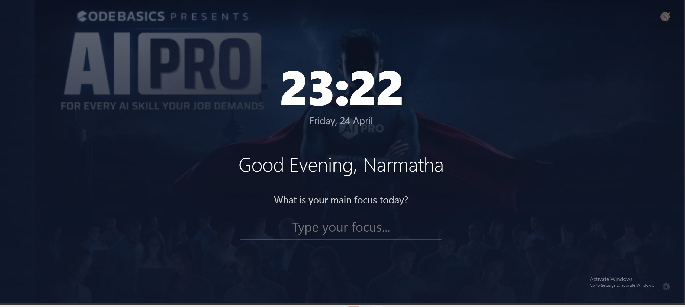
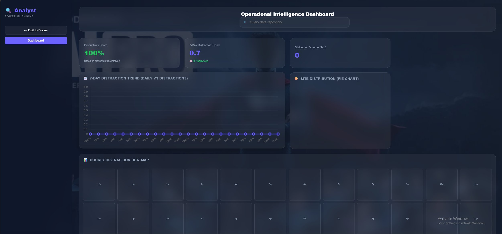
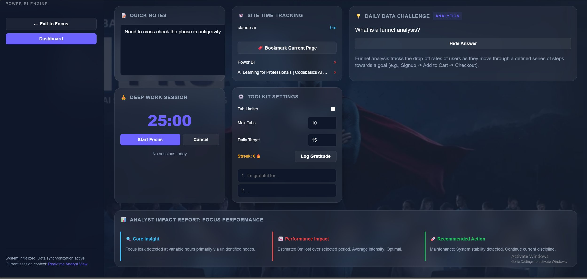
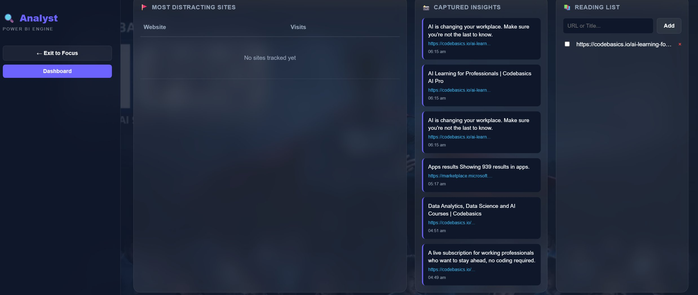

# FocusSense — Focus Tracking and Career Practice

A Manifest V3 Chrome extension project combining distraction tracking, focus sessions, saved insights and daily interview practice. The extension source is packaged inside [AI pro assignment.zip](AI%20pro%20assignment.zip).

## Features

- Distraction logging and domain-level time tracking.
- Focus mode and tab-limit controls.
- A dashboard for browsing activity and focus patterns.
- Saved text snippets and a reading list.
- A new-tab page with SQL, analytics and case-study questions.

These describe the project implementation, not a measured improvement in a user’s productivity. Browser activity can show when distractions happen; it cannot establish why someone was distracted.

## Install locally

1. Download [the source ZIP](AI%20pro%20assignment.zip), or clone this repository and find that ZIP.
2. Extract it. The extension folder is `assignment/focussense/`.
3. Open `chrome://extensions` in Chrome and enable Developer mode.
4. Choose **Load unpacked** and select the extracted `assignment/focussense/` folder containing `manifest.json`. Do not select the repository root or the ZIP itself.
5. Open a new tab to view the extension.

The ZIP also contains `assignment/FocusSense_PRD.md` and `assignment/tasks.md`. Inspect the source before installing. No packaged extension-store release is linked here.

## Source structure inside the ZIP

```text
assignment/
├── FocusSense_PRD.md
├── tasks.md
└── focussense/
    ├── manifest.json
    ├── background.js
    ├── contentScript.js
    ├── dashboard/
    ├── data/questions.js
    ├── libs/chart.js
    ├── newtab/
    └── popup/
```

## Screenshots

### New-tab page


### Analytics


### Focus dashboard


### Saved insights


## Permissions and storage

The manifest requests `storage`, `tabs`, `activeTab`, `scripting`, `idle`, `alarms`, `unlimitedStorage` and `<all_urls>` host access. Review these permissions when loading it. The project uses `chrome.storage.local` for extension data. A complete runtime privacy or security audit is not included in this repository.

## Tools

JavaScript · HTML/CSS · Chrome Manifest V3 · Chart.js

## Project status

The source archive and screenshots are available. Source inspection confirms the manifest and folder structure above; installation and browser behaviour were not retested during this documentation update. No standalone LICENSE file is currently present in this repository.

**Narmatha Annadurai** — [Portfolio](https://codebasics.io/portfolio/Narmatha-Annadurai)
